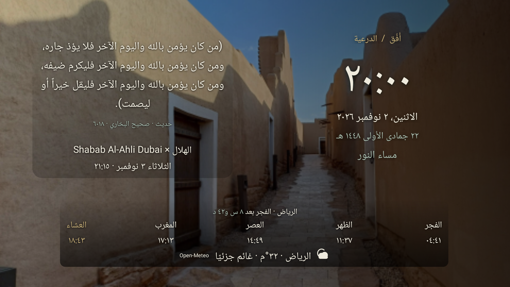
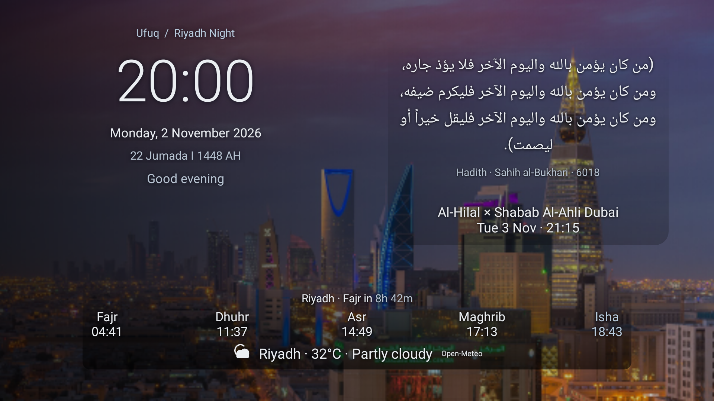
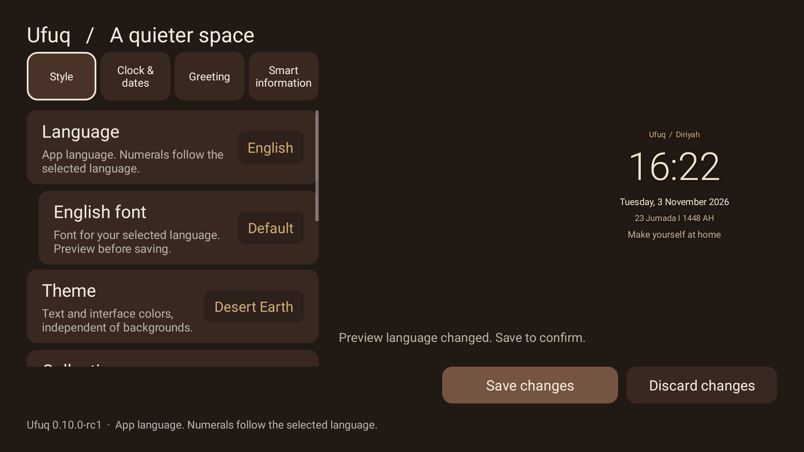

# أُفُق · Ufuq Dream

شاشة توقف سعودية سينمائية لـ **Android TV / Google TV 9+**. مجانية ومفتوحة المصدر، بلا إعلانات أو حسابات أو تتبّع. تعمل الساعة والصور والآية والحديث دون إنترنت؛ المعلومات الشبكية اختيارية.

A free, open-source Saudi cinematic screensaver for Android TV. Native Kotlin Views, Arabic/English, offline core, no ads, accounts or analytics.

**[تحميل APK / Download APK](https://github.com/MansourAlotaibi/ufuq-dream/releases/tag/v0.10.0-rc1)** · [التثبيت / Installation](docs/INSTALL.md) · [English guide](README.en.md) · [حقوق المحتوى / Credits](THIRD_PARTY_NOTICES.md)

## الإصدار الحالي

**0.10.0-rc1 — إصدار عام تجريبي مكتمل الميزات.** النسخة التطويرية المقابلة اختبرها صاحب المشروع واعتمدها على Xiaomi Mi Box S الجيل الأول، Android 9. توقيع الإنتاج مختلف عن نسخة الاختبار؛ لا نغيّر نسخة التلفزيون الخاصة أثناء النشر. يبقى الإصدار RC إلى حين إثبات الاستعادة المستقلة لمفتاح التوقيع واستكمال اختبارات الإنتاج والأجهزة الأوسع. [نتائج الفحص والقيود](docs/0.10.0/RELEASE.md).

## التجربة

- 13 صورة سعودية موثقة الترخيص: العلا 5، الدرعية 3، الرياض 5؛ وثلاثة ثيمات مستقلة: الأخضر السعودي، أرض الصحراء، ليل الرياض.
- معاينة حية كبيرة، تحكم بالريموت، وحفظ/إلغاء صريح. الخيارات الفرعية تظهر عند الحاجة فقط.
- موضع الساعة: تلقائي، يمين أو يسار؛ المعلومات في الجهة المقابلة. الخلفيات الشفافة تتناسب مع النص الظاهر وتختفي حين تُغلق المجموعة.
- العربية والإنجليزية؛ الأرقام تتبع اللغة. صيغة 12/24 ساعة تشمل الساعة والصلاة وموعد المباراة، مع ثوانٍ اختيارية وتاريخ ميلادي وهجري بأم القرى.
- خط اللغة الحالية: القاهرة، تجوال، IBM Plex Arabic، Readex Pro، المراعي؛ وLato للإنجليزية. أرقام الساعة والنص الديني يحتفظان بخطهما المخصص.
- آية أو حديث أو تناوب يومي، بنص عربي كامل ومراجع وتراخيص محفوظة؛ دون اختصار أو ترجمة آلية. المكتبة الحالية 4 آيات و3 مقتطفات متون أحاديث، وليست تطبيق مصحف كاملًا.
- صلاة اختيارية عبر AlAdhan مع تقويم محفوظ لنحو 30 يومًا، أو حساب محلي تختاره صراحة؛ والمدينة وطريقة الحساب محفوظتان. المواقيت محسوبة وليست اعتمادًا رسميًا؛ طابقها مع جدول مسجدك.
- طقس اختياري للمدينة المختارة، مئوي/فهرنهايت، مع حفظ القراءة الأخيرة والتعامل مع انقطاع الشبكة. نسب المصدر ظاهر عند وجود قراءة.
- فريق مفضل ومباراته القادمة، دون شعارات أو نتائج مباشرة. الخدمة قد تتأخر أو تحدّ الاستجابات؛ لا تُختلق مباراة بديلة.
- تحية تلقائية أو جاهزة أو خاصة أو مخفية؛ تدوير 1/3/5 دقائق أو خلفية محددة، وخفض ليلي اختياري غير مفعّل افتراضيًا.

## صور من التطبيق

صور من التصيير الفعلي على المضيف، **وليست صور تلفزيون أو إثبات بيانات حية**. تعرض أوقاتًا وبيانات مرجعية مؤرخة، والنص يُرسم حيًا في التطبيق. [تراخيص الصور والمحتوى الظاهر](docs/0.10.0/images/CREDITS.md).






## الفيديو: دعم كامل، ومحتوى شخصي منفصل

**لا تتضمن النسخة العامة مقاطع فيديو.** المقاطع التي جُرّبت شخصيًا لم يُثبت إذن إعادة توزيعها داخل التطبيق، لذلك لا نرفقها ولا ندّعي أنها متاحة للجميع. مشغّل H.264 العتادي، التكرار، الاستيراد والرجوع للصورة عند الخطأ موجودة. استيراد ملفك يحتاج منتقي ملفات Android فعليًا؛ بعض التلفزيونات لا تتضمنه. عند وجود مقاطع متوافقة تظهر أنواع الخلفيات المتحركة، ويشملها منتقي «الخلفية المحددة». [تفاصيل الفيديو وحدوده](docs/LOCAL-VIDEO.md).

## التثبيت والاستخدام

حمّل APK وSHA256SUMS من الإصدار الرسمي، وانقله للتلفزيون بمثبّت موثوق. افتح أُفُق، خصّص التجربة واحفظ. من إعدادات التلفزيون ← تفضيلات الجهاز ← شاشة التوقف/Daydream اختر أُفُق. أسماء القوائم وتوفر الاختيار تختلف حسب الشركة؛ بعض Google TV تقيّده. لا تحتاج ADB أو Android Studio للاستخدام العادي.

إصدارات الإنتاج العامة تُحدَّث بالتوقيع نفسه. نسخة debug أو نسخة بُنيت بمفتاح آخر لا تقبل تحديث الإنتاج؛ **لا تحذف التطبيق أو تمسح بياناته لتجاوز اختلاف التوقيع**. [الترقية والرجوع](docs/UPGRADE-ROLLBACK.md).

## البناء والمساهمة

JDK 17 أو 21، Android SDK 34 وbuild-tools 34.0.0. يستخدم CI ‏Temurin 17؛ لا أسرار توقيع في GitHub Actions.

```sh
./gradlew assembleDebug assembleRelease lintDebug lintRelease test
python3 tools/check_public_assets.py
python3 tools/check_repository.py
# Optional technical media tests: install ffmpeg/ffprobe first
python3 -m unittest discover -s tools -p 'test_*.py'
```

APK التطوير: `app/build/outputs/apk/debug/app-debug.apk`؛ إصدار release غير موقّع حتى يوقّعه المسؤول بالمفتاح المحفوظ خارج المستودع. [التوقيع](docs/SIGNING.md) · [المساهمة](CONTRIBUTING.md) · [الأمان](SECURITY.md) · [البنية](docs/ARCHITECTURE.md).

## الخصوصية والتراخيص

لا موقع دقيق أو ميكروفون أو تحليلات أو خدمات تتبع. INTERNET وACCESS_NETWORK_STATE للمعلومات الاختيارية بعد حفظ الموافقة وأثناء ظهور المعاينة/شاشة التوقف. الكود MIT؛ الصور والقرآن والحديث والخطوط لها تراخيص منفصلة. MIT لا يمنح ترخيصًا غير محدود لخدمات API أو الوسائط. هذا الإصدار مجاني غير تجاري على GitHub؛ إعادة النشر التجاري أو في المتاجر تحتاج مراجعة شروط المزودين. [الخصوصية](PRIVACY.md) · [المصادر والشروط](docs/0.10.0/PROVIDERS.md).

[سجل الإصدارات](CHANGELOG.md) · [الخطوات القادمة](ROADMAP.md) · [فحص التلفزيون](docs/TV-ACCEPTANCE.md). حركة النص تخفف الثبات، ولا تضمن منع احتراق الشاشة. لا انتماء رسمي أو اعتماد من جهة سياحية أو مزود بيانات أو شركة أجهزة.
