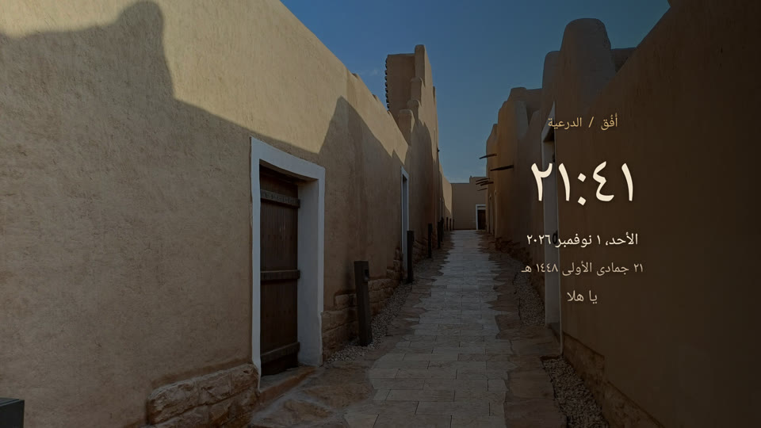
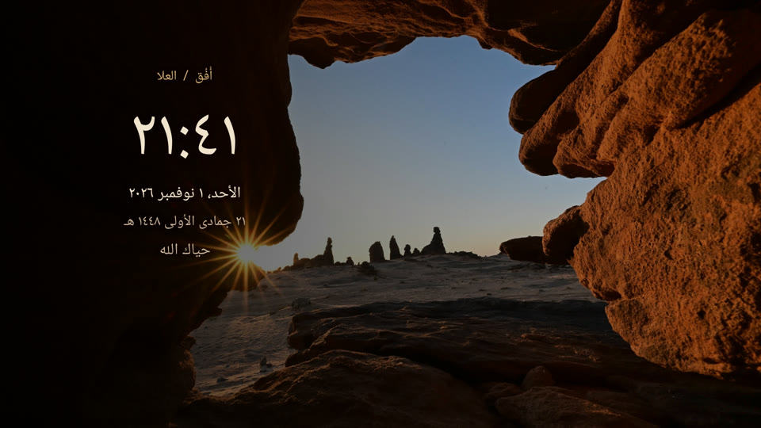

# أُفُق · Ufuq Dream

شاشة توقف سعودية هادئة لـ Android TV، مصممة للبيت والريموت. مجانية وبلا إعلانات. التجربة الأساسية دون إنترنت؛ الصلاة والطقس اختياريان.

A Saudi cinematic screensaver for Android TV. Native Kotlin Views, Arabic-first, offline core, optional online/offline prayer calculations and opt-in weather, no ads or analytics.

## الحالة / Status

**v0.9.0-rc1 — public release candidate / مرشح إصدار تجريبي، وليس Stable.** Android TV 9+ (API28). The underlying debug build has been exercised on Xiaomi Mi Box S; production-signed isolated-device acceptance, sleep/wake and signing-key disaster-recovery verification remain open. Android TV / Google TV compatibility beyond that device is assessed by host tests, not certified physical coverage. See [validation and limitations](docs/0.9.0/STABILITY-RC.md).

## ما تتضمنه النسخة العامة

- 13 Saudi photographs: AlUla (5), Diriyah (3), Riyadh (5), with individual source/license records and in-app credits.
- Three independent visual palettes: Saudi Green, Desert Earth, Riyadh Night.
- Large live customization preview, explicit Save/Cancel, D-pad navigation and nine clock positions plus Automatic.
- Arabic / English app language, matching numerals automatically, 12/24-hour clock, optional seconds, Gregorian and Umm al-Qura Hijri dates.
- Optional prayer times with a validated rolling 30-day offline cache; opt-in weather, manual cities and no location permission.
- Current prayer highlighted; only the next-prayer countdown has a secondary tint. Either horizontal D-pad arrow returns from settings rows to their tab.
- Automatic, predefined, custom or hidden greeting; optional night dimming, off by default.
- Subtle text shifts and 1/3/5-minute photo rotation or a fixed image. Movement does not guarantee prevention of display burn-in.

**No videos are included in the public source/APK.** Personal testing used a separately obtained local video; it is excluded from public distribution. Without eligible local media the app uses photos and hides motion-only controls. Where a real Android document/file picker is installed, use **Import a video / إضافة فيديو من ملفاتك** for your own compatible silent MP4. Some TVs have only a stub picker: import is hidden there; previously imported clips remain selectable through Video Library when fixed-background mode is chosen. No working file picker is bundled or automatically installed. See [Local video](docs/LOCAL-VIDEO.md). Do not expect a fresh public install to contain the personal video shown in private testing.

## معرض / Gallery

Host-rendered examples using the actual app renderer; not photographs of a physical TV. Clock and dates are live in the app, not baked into the backgrounds. [Screenshot credits and licenses](docs/images/CREDITS.md).





## Download and install / التحميل والتثبيت

Get the production-signed APK and SHA256SUMS from [Releases](https://github.com/MansourAlotaibi/ufuq-dream/releases). [Installation guide / دليل التثبيت](docs/INSTALL.md). Android 9+ TV, landscape, D-pad. Existing differently signed debug installs cannot be updated in place; [upgrade and rollback](docs/UPGRADE-ROLLBACK.md). The APK includes photos and supports personal video import, but contains no bundled video.

## Build / البناء

JDK 17, Android SDK platform 34 and build tools 34.0.0. Android Studio can provision the SDK. The Gradle wrapper downloads build dependencies; the clock/photo experience is offline; online prayer and weather widgets are optional.

```sh
./gradlew assembleDebug assembleRelease lintDebug lintRelease test
python3 tools/check_public_assets.py
# Optional media-pipeline tests, requires ffmpeg and ffprobe:
python3 -m unittest discover -s tools -p 'test_*.py'
```

Output: `app/build/outputs/apk/debug/app-debug.apk`. This is a **debug build**, not a production-signed release. Independent builders have different signing keys. Never uninstall or clear data merely to bypass a certificate mismatch.

Install your build using your TV's normal APK installer, or an explicitly authorized developer workflow. Select أُفُق in the TV's native Settings → Screensaver / Daydream; menu names differ by manufacturer. There is no automatic default/launcher replacement. Save customization explicitly before leaving settings.

## Privacy and safety

The app requests INTERNET for saved opt-in weather/online prayers and normal ACCESS_NETWORK_STATE for connectivity awareness; no account,telemetry,microphone,location or wake-lock permission. Preferences and user-selected local media stay in app-internal storage. No root, firmware operation, launcher change or adopted-storage operation is performed. Uninstalling removes app-local settings/media. See [privacy](PRIVACY.md).

## Documentation

- [Architecture](docs/ARCHITECTURE.md)
- [Local video](docs/LOCAL-VIDEO.md)
- [Signing](docs/SIGNING.md)
- [Release readiness and feature parity](docs/release/READINESS.md)
- [Photo rights and credits](THIRD_PARTY_NOTICES.md)
- [TV acceptance checklist](docs/TV-ACCEPTANCE.md)
- [Roadmap](ROADMAP.md)
- [Contribution guide](CONTRIBUTING.md)
- [Release checklist](docs/RELEASE-CHECKLIST.md)

## License

Application code and project-authored documentation: [MIT](LICENSE). Photographs and their thumbnails retain their individual **CC BY / CC BY-SA** licenses; they are not relicensed under MIT. Preserve creator/title/source/license/change notices when redistributing. Third-party build tools and dependencies retain their own licenses. No endorsement by Saudi tourism bodies, photo creators or device manufacturers is implied.

## Smart Ambient / المعلومات الذكية
Prayer times via AlAdhan or an explicitly selected offline calculation; next prayer/countdown, Saudi-first manual cities. Online calendar data are calculated, not certified official mosque schedules. Coverage is 30 exact Gregorian dates, refreshed before expiry with bounded retries; errors never silently switch calculation source. Weather provides current model temperature/condition, C/F, 30/60/180-minute active-only refresh and validated cached fallback. Both widgets default off and require Save. Preview never fabricates live readings or grants unsaved network consent. Sources and calculation details are available in credits/settings. Open-Meteo attribution remains adjacent to actual readings. Its free hosted endpoint is for non-commercial use; MIT code licensing does not grant commercial forks unrestricted API access. [Provider details and limitations](docs/0.9.0/SMART-AMBIENT.md).

واجهة عربية وإنجليزية، والأرقام تتبع اللغة تلقائيًا. الصلاة والطقس اختياريان ولا يحتاجان صلاحية الموقع. المواقيت محسوبة ويجب مطابقتها مع جدول مسجدك؛ ليست اعتمادًا رسميًا. الصور مرخّصة، ولا تتضمن النسخة العامة فيديوهات الاختبار الشخصية. كل تغيير في المعاينة يحتاج الحفظ الصريح. النسخة تجريبية وتبقى القيود موضحة في تقرير التحقق.

[Smart Ambient visual review gallery](docs/0.9.0/gallery.html) | [Arabic Studio](docs/0.9.0/images/studio-smart.png) · [English Studio](docs/0.9.0/images/studio-en.png) (host-rendered,not a physical-TV test).
